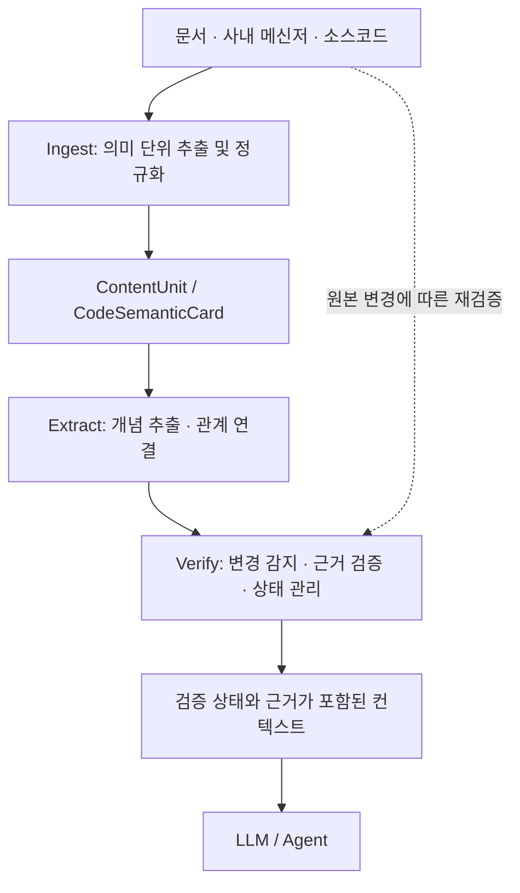

# LLM은 똑똑한데, 왜 우리 회사 일은 모를까?

원문: [토스 기술 블로그](https://toss.tech/article/llm_context_topic)

## 1. Topic이 해결하려는 문제

LLM은 학습 과정에서 접하지 못한 회사 내부의 정책이나 서비스 동작을 정확하게 알기 어렵다. 이를 보완하기 위해 RAG를 활용하면 사내 문서나 소스코드에서 관련 정보를 검색하고, 이를 LLM의 컨텍스트로 제공할 수 있다.

하지만 관련 정보를 검색할 수 있다는 것이 정확한 답변을 보장하지는 않는다. 사내 정보는 문서, 코드, 메신저 등에 분산되어 있으며, 오래되었거나 서로 다른 내용을 설명하고 있을 수도 있기 때문이다.

결국 중요한 것은 **정보를 얼마나 잘 검색하느냐뿐 아니라, 검색된 정보를 얼마나 신뢰할 수 있느냐**이다.

토스의 Topic은 이러한 문제를 해결하기 위해 정보의 출처와 최신성, 정보 간의 관계 등을 관리하는 컨텍스트 계층이다.

## 2. 신뢰할 수 있는 컨텍스트의 여섯 가지 조건

Topic은 정보의 신뢰성을 하나의 점수로 평가하지 않고, 여섯 가지 조건으로 구분한다.

신뢰도가 높더라도 원문 근거가 부족한 것인지, 정보가 오래된 것인지에 따라 해결 방법이 달라지기 때문이다.

| 조건 | 의미 및 예시 |
|---|---|
| **Granularity** | 독립적으로 이해할 수 있는 정보 단위인가? 문서를 일정한 길이로 분할하면 하나의 정책 설명이 여러 청크로 나뉠 수 있다. |
| **Faithfulness** | 설명을 원문이 뒷받침하는가? LLM이 설명한 재시도 횟수가 실제 코드와 다를 수 있다. |
| **Staleness** | 근거가 현재도 유효한가? 코드가 변경되었다면 이전 설명을 재검증해야 할 수 있다. |
| **Canonicality** | 서로 다른 표현이 같은 개념인가? `회원 탈퇴`와 `계정 삭제`가 동일한 업무를 의미할 수 있다. |
| **Consistency** | 서로 다른 정보가 양립할 수 있는가? 운영 문서와 코드의 재시도 정책이 다를 수 있다. |
| **Coverage** | 중요한 근거가 누락되지 않았는가? `OrderService`만 분석하면 `PaymentClient`의 재시도 로직을 놓칠 수 있다. |

토스는 이 조건들을 하나의 검증 모델로 해결하지 않는다. 규칙 기반 검사, LLM의 의미 해석, 사람의 판단을 필요에 따라 구분해 적용한다.

### Topic의 전체 처리 흐름



*원문의 논리적 처리 단계를 단순화한 개념도다.*

## 3. Ingest — 정보를 의미 단위로 정규화

Ingest는 서로 다른 출처의 정보를 수집하고, 이후 단계에서 일관되게 처리할 수 있도록 정규화하는 과정이다.

토스는 이를 위해 `ContentUnit`이라는 공통 구조를 정의했다. 여기에는 원본의 출처와 위치, 본문, 변경 감지를 위한 해시, 생성·수정 시각 등이 포함된다.

정보를 분할하는 방식은 출처에 따라 다르게 적용했다.

- **문서:** 제목과 섹션의 계층을 유지한다.
- **메신저:** 대화 스레드를 단위로 삼아 결정 사항과 미결정 사항을 구분한다.
- **코드:** 함수나 클래스 등의 심볼을 추출하고, 여러 심볼에 걸친 비즈니스 동작을 별도로 표현한다.

### CodeSemanticCard — 코드의 동작을 의미 단위로 표현

소스코드는 개별 함수만으로 전체 비즈니스 동작을 설명하기 어렵다.

예를 들어 회원 탈퇴 기능은 인증 토큰 삭제, 구독 관계 정리, 사용자 정보 삭제 등 여러 클래스와 함수에 걸쳐 구현될 수 있다.

토스는 파서를 이용해 코드의 구조적 정보를 추출하고, LLM 에이전트가 관련 코드를 탐색해 `CodeSemanticCard`를 생성한다.

다음은 이해를 돕기 위한 가상의 예시다.

```yaml
subject: 회원 탈퇴
behavior: >
  사용자 인증 토큰과 구독 관계를 정리하고
  계정 정보를 삭제한다.
domain_terms:
  - 회원 탈퇴
code_terms:
  - UserService.withdrawUser
spans:
  - file: UserService.java
    symbol: withdrawUser
commit_sha: abc123
```

`subject`는 카드의 주제이고, `behavior`는 코드의 동작을 설명한다. `spans`와 `commit_sha`는 설명의 근거가 되는 코드와 버전을 추적하기 위한 정보다.

모든 심볼을 LLM으로 분석하는 것은 비용이 크기 때문에, 토스는 import graph에서의 중요도와 변경 빈도 등을 고려해 분석 우선순위를 결정한다. 생성된 카드 역시 근거 코드와 위치가 유효한지 검증한다.

즉, **CodeSemanticCard는 실제 코드를 대체하는 문서가 아니라, 코드의 비즈니스 동작과 원본 근거를 연결하는 중간 표현**이다.

## 4. Extract — 개념과 관계를 추출

Extract는 ContentUnit에서 개념을 추출하고, 서로 다른 출처의 정보가 어떤 관계를 가지는지 파악하는 과정이다.

### 임베딩 검색과 개념 통합

서로 다른 출처에서 동일한 개념을 다른 표현으로 설명할 수 있다.

이를 찾는 데 활용하는 기술이 **임베딩(Embedding)**이다. 임베딩은 텍스트의 의미적 특성을 숫자 벡터로 표현하며, 코사인 유사도 같은 방법으로 벡터 간 유사성을 비교할 수 있다.

다만 **유사도가 높다고 해서 두 정보의 주장이 일치하는 것은 아니다.**

- A: 결제 실패 시 최대 3회 재시도한다.
- B: 결제 실패 시 재시도하지 않는다.

두 문장은 같은 결제 재시도 정책을 설명하지만, 실제 주장은 서로 충돌한다.

따라서 토스는 임베딩 검색을 관계의 일치 여부를 확정하는 수단이 아니라, **의미 검증이 필요한 후보를 찾는 수단**으로 활용한다.

또한 서로 다른 표현이 같은 대상을 가리키는 경우 대표 개념인 `Canonical Concept`으로 통합한다. 다만 모호한 별칭은 자동으로 병합하지 않고 사람의 승인을 거친다.

앞서 살펴본 `CodeSemanticCard.subject`는 개별 카드의 주제인 반면, Canonical Concept은 여러 출처의 표현을 통합한 대표 개념이다.

### 관계 검증

토스는 관련성이 높은 후보를 의미적으로 검증해 다음과 같은 관계를 생성한다.

| 관계 | 의미 |
|---|---|
| `supported_by` | 원문 근거가 주장을 뒷받침함 |
| `contradicted_by` | 원문 근거가 주장과 충돌함 |
| `mentions` | 관련은 있지만 지지·충돌을 판단하기 어려움 |

앞선 재시도 정책을 예로 들면, 문서에는 3회 재시도한다고 기록되어 있지만 실제 코드에서 재시도를 수행하지 않는다면 `contradicted_by` 관계가 될 수 있다.

반대로 코드에서 결제 관련 로깅만 확인된다면, 재시도 정책을 뒷받침하거나 반박하기 어려우므로 `mentions`에 해당할 수 있다.

이 사례는 관계 유형을 설명하기 위한 가상의 예시다.

검증 결과에는 관계 유형과 근거, 판단 상태 등을 함께 저장하며, 충분한 근거가 없으면 관계를 확정하지 않는다.

결국 **Extract는 관련 정보를 찾는 데서 끝나지 않고, 원문 근거를 바탕으로 정보 간의 관계를 구성하는 과정**이다.

## 5. Verify — 정보의 신뢰성을 지속적으로 검증

Ingest와 Extract를 통해 생성한 정보와 관계는 원본 문서나 코드가 변경되면 더 이상 유효하지 않을 수 있다.

토스는 매번 전체 정보를 LLM으로 검증하는 대신, 해시를 이용해 변경 여부를 감지하고 필요한 부분만 다시 검증한다.

`ContentUnit`은 `content_hash`를 활용하고, 코드의 경우 `commit_sha`와 `span_hash` 등을 이용해 검증 당시의 근거와 현재 코드를 비교한다.

- **fresh:** 근거 코드가 변경되지 않아 기존 검증을 재사용할 수 있는 상태
- **orphaned:** 근거 코드의 위치를 더 이상 찾을 수 없는 상태
- **변경 감지:** 코드가 변경되어 기존 설명에 대한 의미적 재검증이 필요한 경우

코드가 변경되었다고 기존 설명이 반드시 틀린 것은 아니다. 변경은 재검증이 필요하다는 신호로 사용된다.

또한 정보가 충돌하면 어느 한쪽을 임의로 정답으로 결정하지 않고, 각각의 근거와 `disputed`, `stale_risk` 등의 상태를 보존한다. 사람이 확인한 판단도 이후 컨텍스트 선택에 반영할 수 있다.

즉, **Verify는 재검증 비용을 줄이면서 정보의 최신성과 불확실성을 지속적으로 관리하는 과정**이다.

## 6. 정리

사내 정보를 LLM에 제공하는 것만으로는 신뢰할 수 있는 답변을 보장하기 어렵다. 정보가 어떤 근거에서 비롯되었는지, 현재도 유효한지, 다른 정보와 충돌하지는 않는지 확인하는 과정이 필요하기 때문이다.

Topic은 이러한 정보를 단순히 수집하는 데 그치지 않고, 각각의 근거와 검증 상태를 함께 관리한다.

결국 **신뢰할 수 있는 컨텍스트란 많은 정보를 제공하는 것이 아니라, 어떤 정보를 어디까지 신뢰할 수 있는지 판단할 근거를 제공하는 것**이라는 점에서 의미 있는 설계라고 생각한다.