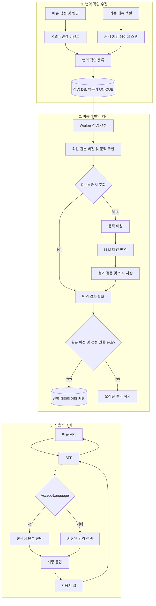

## 1. 5년 동안 해결하지 못했던 이유

배민의 다국어 지원은 단순히 메뉴명을 번역하는 문제가 아니었다.

수십만 개의 가게와 수천만 개의 메뉴를 여러 언어로 번역해야 했고, 지속적으로 변경되는 데이터를 관리할 파이프라인도 필요했다. 다국어 데이터 저장 구조와 운영 도구, 번역 품질 기준까지 고려하면 기존 방식으로는 구축과 유지보수 비용이 지나치게 컸다.

이후 두 가지 조건이 갖춰지면서 상황이 달라졌다.

- **FDH(Food Data Hub):** 2024년 12월 구축된 대용량 데이터 처리 기반
- **LLM의 발전:** 음식의 문맥을 반영할 수 있는 번역 품질과 낮아진 연동 난이도

즉, LLM만 도입한 것이 아니라 **이미 구축된 대용량 데이터 파이프라인에 LLM을 결합한 것**이 핵심이었다.

## 2. 다국어 처리 아키텍처

원문의 전체 구조는 번역 파이프라인과 사용자 응답 처리로 구분된다.

### FDH Translation Pipeline

**가게·메뉴 변경 이벤트 → FDH Worker → LLM 번역 → 언어별 메타데이터 저장**

가게나 메뉴 데이터가 변경되면 이벤트가 발행되고, FDH Worker가 이를 비동기로 처리한다.

번역 결과는 영어·일본어·중국어 메타데이터로 미리 저장한다. 따라서 사용자가 메뉴를 조회할 때마다 LLM을 호출하지 않는다.

### Backend BFF Handling

**사용자 요청 → Accept-Language 확인 → 저장된 번역 데이터 매핑 → 응답**

BFF(Backend For Frontend)는 클라이언트에 필요한 형태로 데이터를 가공하고 제공하는 백엔드 계층이다.

FDH가 번역 결과의 생성을 담당한다면, BFF는 사용자 언어에 적합한 데이터를 선택해 응답에 반영한다.

다만 원문만으로 BFF가 독립된 서버인지, 여러 마이크로서비스를 호출해 응답을 조합하는지는 확인할 수 없다.

### 정적 문구와 동적 데이터의 분리

| 데이터 | 처리 방식 |
|---|---|
| 가게명, 메뉴명 등 동적 콘텐츠 | LLM 기반 비동기 번역 |
| 버튼명 등 정적 UI 문구 | i18n 정적 파일 |

정적 문구는 `global`(공통 용어)과 `local`(지면·서버별 문구)로 분리해 관리했다.

## 3. LLM을 실제 서비스에 적용하면서 발생한 문제

Spring AI와 AWS Bedrock 연동 기반을 활용해 빠르게 PoC를 구현했지만, 프로덕션 환경에 적용하기 위해서는 추가적인 안정화가 필요했다.

### ① 단건 번역에서 다건 번역으로

한 건씩 LLM을 호출하면 비용과 처리 시간 측면에서 비효율적이다.

이를 개선하기 위해 여러 문자열을 배열로 요청하고 결과도 배열로 반환받도록 변경했다.

**대량 번역에서는 단순한 모델 성능뿐 아니라 호출 횟수와 처리 효율을 개선하는 배칭 전략이 중요하다.**

### ② LLM 응답 형식의 불안정성

번역 결과에 개행문자가 예상과 다르게 나타나거나, LLM이 입력 내용을 보고 JSON 필드명을 임의로 변경하는 문제가 발생했다.

이를 해결하기 위해 프롬프트에 출력 형식과 필드명을 명시적으로 지정했다.

LLM 연동은 단순히 API를 호출하는 것으로 끝나지 않으며, **응답 형식의 일관성과 예외 상황을 관리하는 과정**이 필요하다.

### ③ 기존 데이터 마이그레이션

신규 변경 이벤트만 처리해서는 이미 존재하는 가게와 메뉴를 번역할 수 없다.

배민도 전체 오픈에 앞서 기존 가게 데이터를 마이그레이션해야 했다. 이 과정에서 대량 번역 비용을 고려해 Claude Haiku에서 Amazon Nova 2 Lite로 모델을 변경하고, 프롬프트와 배치 처리 인프라를 재조정했다.

즉, 다국어 도입에는 **기존 데이터의 백필과 이후 변경되는 데이터의 증분 처리**가 모두 필요했다.

## 4. 읽으면서 직접 설계해본 아키텍처

*이하 내용은 원문의 구현 사실이 아니라, 해당 사례를 바탕으로 추가로 고민한 설계다. Kafka, Redis, 작업 상태 DB 등의 사용을 가정했다.*

### 전체 아키텍처



번역 생성 경로와 사용자 조회 경로를 분리했다.

- **번역 생성:** 이벤트 수집, 백필, 멱등성 관리, 캐시 조회, 동적 배칭, LLM 번역, 버전 검증을 담당한다.
- **사용자 조회:** 미리 저장된 데이터를 이용해 사용자 언어에 맞는 응답을 구성한다.

다이어그램에서는 메뉴 API가 번역 메타데이터를 조회해 BFF에 제공한다고 가정했다. 실제 데이터 조회 및 서비스 호출 구조는 구현에 따라 달라질 수 있다.

### ① 백필과 증분 처리의 통합

메뉴 변경 이벤트만으로는 수정되지 않은 기존 데이터를 번역할 수 없으므로, 최초 다국어 도입 시 별도의 백필이 필요하다.

백필은 커서 기반으로 기존 데이터를 나누어 읽고 번역 작업을 등록하는 방식으로 구성할 수 있다.

**백필과 변경 이벤트가 동일한 번역 작업 처리 파이프라인으로 합류하도록 설계**하면, 멱등성 관리와 캐싱, 배칭, 재시도 로직을 공통으로 사용할 수 있다.

다만 두 작업의 특성은 다르다.

| 구분 | 증분 처리 | 백필 |
|---|---|---|
| 대상 | 신규 및 변경 데이터 | 기존 데이터 |
| 작업 발생 | 불규칙적 | 대량 발생 |
| 우선순위 | 상대적으로 높음 | 상대적으로 낮음 |
| 처리 전략 | 지연 시간 고려 | 처리량과 비용 고려 |
| 진행 관리 | 작업별 상태 | 스캔 커서 및 작업별 상태 |

백필 작업이 대량으로 쌓이더라도 신규 변경 데이터의 처리가 지나치게 지연되지 않도록 작업 우선순위를 고려할 필요가 있다.

또한 스캔 커서는 **어디까지 작업을 등록했는지**를 나타내며, 해당 범위의 번역이 모두 완료되었다는 의미는 아니다.

### ② 멱등성과 작업 선점

Kafka Consumer Group은 같은 파티션을 정상적으로 둘 이상의 Consumer에 동시에 할당하지 않는다.

하지만 장애로 인해 Offset 커밋 전에 프로세스가 종료되거나 동일한 이벤트가 중복 발행되면, 번역 작업이 재실행될 수 있다.

LLM 호출은 비용이 발생하므로 중복 실행을 최소화할 필요가 있다.

다음과 같은 멱등키를 고려했다.

```text
menuId + sourceVersion + language + policyVersion
```

동일한 작업이 이미 등록되어 있다면 중복 등록을 방지하고, Worker가 작업을 선점해 처리하도록 구성한다.

단순히 선점된 작업을 스킵하기보다는 다음과 같은 작업 상태를 관리하는 것이 적절하다.

- `PENDING`: 처리 대기
- `PROCESSING`: 처리 중
- `COMPLETED`: 처리 완료
- `FAILED`: 처리 실패

Worker 장애를 고려해 선점 만료 시간(Lease)을 두고, 기존 Worker가 뒤늦게 결과를 반영하지 못하도록 선점 권한도 검증해야 한다.

### ③ 원본 버전 검증과 변경 이벤트 병합

비동기 처리에서는 번역 작업의 완료 순서가 원본 데이터의 변경 순서와 다를 수 있다.

예를 들어 다음과 같은 상황이 발생할 수 있다.

1. 백필이 메뉴의 `v1` 데이터를 읽는다.
2. 메뉴가 수정되어 `v2`가 생성된다.
3. `v2` 번역이 먼저 완료된다.
4. 뒤늦게 `v1` 번역이 완료된다.

이때 오래된 `v1` 번역이 최신 데이터를 덮어쓰지 않도록 **현재 원본 버전과 번역 결과의 버전을 비교해야 한다.**

단순히 번역 테이블에 저장된 버전만 비교하는 것으로는 충분하지 않을 수 있다. 현재 메뉴 원본의 버전을 기준으로 결과 반영 여부를 판단하고, 필요한 검증과 저장을 원자적으로 처리해야 한다.

또한 메뉴 변경은 반드시 강한 실시간성을 요구하지 않으므로, 짧은 시간에 여러 번 변경되었다면 중간 버전의 작업을 합쳐 **최신 상태만 번역하는 Coalescing 전략**도 고려할 수 있다.

### ④ 번역 결과 캐싱

여러 가게에서 동일한 메뉴명이 등장할 수 있으므로, 이미 생성된 번역 결과를 재사용하면 LLM 호출 비용을 줄일 여지가 있다.

다만 메뉴명만 캐시 키로 사용하기에는 문제가 있다.

예를 들어 동일한 단어라도 메뉴 카테고리나 설명에 따라 적절한 번역이 달라질 수 있다.

따라서 캐시 키에 다음 정보를 반영하는 방식을 생각했다.

```text
translation:{language}:{contextHash}:{policyVersion}
```

`contextHash`는 메뉴명과 번역에 영향을 주는 설명, 카테고리 등의 정규화된 문맥으로 생성한다.

번역에 영향을 주는 원본 정보가 변경되면 문맥 해시도 달라지므로 기존 캐시를 논리적으로 무효화할 수 있다.

Redis 캐시는 결과 재사용을 위한 최적화 수단으로 사용하고, 실제 번역 메타데이터는 별도 영속 저장소에 관리하는 구조를 고려했다.

### ⑤ 동적 배칭과 비용 최적화

원문에서는 단건 번역을 다건 번역으로 변경했지만, 이를 발전시켜 **작업량에 따라 LLM 요청을 동적으로 묶는 방식**을 생각해볼 수 있다.

예를 들어 다음 조건 중 하나를 만족하면 배치를 실행한다.

- 일정 작업 건수 도달
- 입력 토큰 수의 상한 도달
- 최대 대기 시간 도달

이는 Kafka Producer의 `batch.size`, `linger.ms`와 유사한 발상이지만, 실제 LLM 요청을 묶는 로직은 애플리케이션 계층에서 별도로 구현해야 한다.

배치 크기는 컨텍스트 윈도 크기만으로 결정할 수 없다. 토큰 비용, 응답 지연, 처리량, 형식 오류율, 재시도 비용을 함께 측정해야 한다.

특히 백필은 작업량이 많으므로 처리량 중심으로, 증분 번역은 상대적으로 짧은 대기 시간을 유지하도록 배칭 정책을 다르게 적용할 수 있다.

### ⑥ BFF와 MSA의 책임 분리

BFF는 번역 데이터를 선택하는 역할뿐 아니라 메뉴, 가게, 사용자, 리뷰 등 **클라이언트 화면을 구성하는 여러 도메인의 데이터를 조합하는 역할**도 수행할 수 있다.

이를 통해 도메인 서비스는 비즈니스 데이터 제공에 집중하고, BFF는 클라이언트에 적합한 응답을 구성하도록 책임을 구분할 수 있다.

MSA 관점에서는 서비스별 트래픽 특성에 맞춰 독립적으로 스케일링할 수 있다는 이점도 고려할 수 있다.

예를 들어 한국어 사용자가 대다수라면 한국어 응답은 원본 데이터를 그대로 사용하고, 외국어 응답에서만 추가적인 번역 데이터 매핑이 필요할 수 있다.

다만 배민 원문에서는 번역 결과를 미리 적재하므로 BFF가 요청마다 별도의 번역 서비스를 호출한다고 단정할 수 없다.

또한 BFF 자체가 독립적인 스케일링을 보장하는 것은 아니며, **실제 서비스의 배포 단위와 트래픽 특성**에 따라 이점이 달라진다.

## 5. 정리

이번 사례에서 인상적이었던 것은 **LLM 자체보다 LLM을 기존 시스템에 어떻게 결합했는가**이다.

대규모 데이터 처리는 FDH에 맡기고, 번역은 비동기로 수행하며, 사용자 요청에서는 미리 준비한 결과를 활용했다. 이처럼 번역 생성과 조회 경로를 분리한 설계는 대규모 데이터 처리와 서비스 응답 성능을 함께 고려한 접근이었다.

또한 직접 아키텍처를 고민하면서, 신규 변경 이벤트뿐 아니라 기존 데이터 백필, 중복 실행 방지, 원본 버전 정합성, 캐싱과 배칭까지 고려해야 실제 운영 가능한 시스템에 가까워진다는 점을 생각해볼 수 있었다.

**결국 새로운 기술의 가치는 기술 자체의 성능뿐 아니라, 기존 시스템의 제약을 얼마나 효과적으로 해결하고 안정적인 서비스 구조에 녹여낼 수 있는가에 달려 있다는 점에서 의미 있는 사례라고 생각한다.**