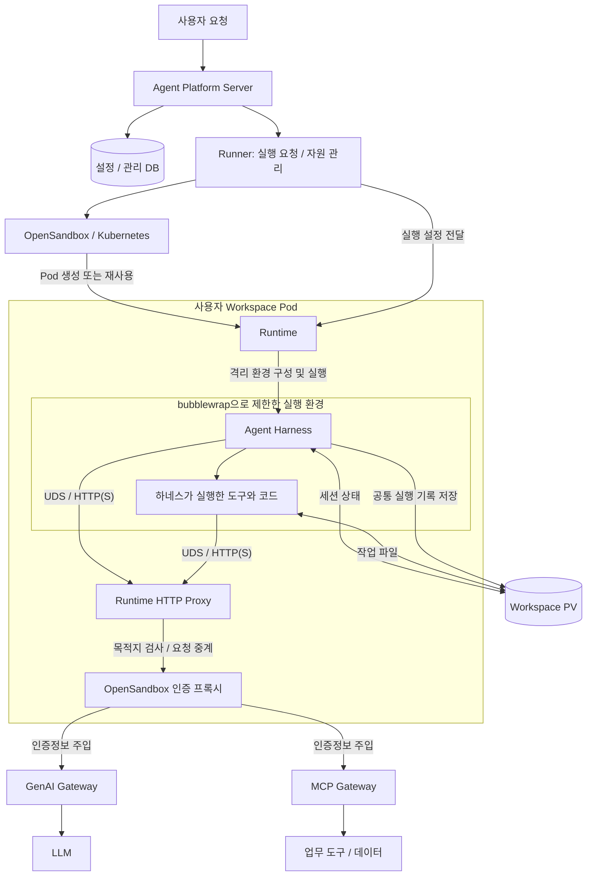

# W03. 실행은 격리하고, 세션은 이어간다 - 망분리 환경의 Agent Platform 설계기

## 1. Agent Platform이 해결하려는 문제

토스는 망분리 환경에서 AI Agent가 내부 데이터를 조회하고, 코드를 실행하며, 이전 분석을 이어갈 수 있는 플랫폼을 구축했다.

이 과정에서 해결해야 할 요구사항은 크게 두 가지였다.

- **실행 격리:** LLM이 생성한 코드가 허용되지 않은 파일이나 내부 시스템에 접근하지 못하도록 제한해야 한다.
- **세션 유지:** Pod가 종료되거나 교체되더라도 이전 작업 파일과 대화 상태를 활용할 수 있어야 한다.

이를 위해 Kubernetes 기반의 Workspace를 구성하고, 내부에서는 bubblewrap으로 Agent 실행 환경을 격리했다. 작업 파일과 세션 상태는 PV에 저장해 실행 환경의 생명주기와 분리했다.

## 2. 전체 아키텍처와 실행 흐름

*원문 아키텍처를 바탕으로 주요 구성 요소와 책임을 표현한 개념도이며, 네트워크 정책과 내부 통신의 세부 사항은 생략했다.*

### ① 실행 환경 준비

사용자가 요청하면 Server가 인증과 접근 권한을 확인하고, Runner가 Workspace 실행 환경을 준비한다.

Server는 플랫폼의 설정과 관리 정보를 별도 DB에서 관리하며, Runner는 **Agent 실행 요청을 조율하고 Workspace 실행 자원을 관리**한다.

OpenSandbox는 Kubernetes를 이용해 사용자별 Workspace Pod를 생성하거나 종료한다. Runner는 준비된 Workspace의 Runtime에 실행 설정을 전달하고, Runtime은 bubblewrap으로 격리된 환경을 구성해 Agent Harness를 실행한다.

여기서 **Harness는 LLM 자체가 아니라, LLM과 도구를 반복 호출하며 실제 작업을 수행하는 프로그램**이다.

### ② Agent 실행 및 네트워크 통제

Harness는 격리된 환경에서 동작하며, 허용된 폴더와 통신 경로에만 접근할 수 있다.

네트워크를 직접 사용하도록 허용하는 대신, Unix Domain Socket을 통해 Runtime HTTP 프록시에 요청을 전달한다.

이후 여러 단계에서 요청을 통제한다.

- **Runtime HTTP Proxy:** 요청 목적지를 검사하고 허용되지 않은 내부 주소를 차단
- **OpenSandbox Egress 정책:** 실제로 통신할 수 있는 목적지 제한
- **OpenSandbox 인증 프록시:** 대체 인증정보를 실제 API 키로 교체
- **GenAI Gateway:** LLM 호출과 모델 사용 권한 관리
- **MCP Gateway:** 업무 도구 호출과 도구 사용 권한 관리

이를 통해 Harness가 실제 인증정보를 직접 전달받지 않으면서도 필요한 서비스를 호출할 수 있도록 했다.

특히 **LLM 호출과 업무 도구 호출은 서로 다른 Gateway를 거친다.** LLM은 수행할 작업과 도구 호출을 결정하고, Harness가 실제 도구를 실행하거나 MCP Gateway를 통해 외부 업무 서비스의 기능을 호출한다.

### ③ 작업 파일과 세션 유지

Workspace Pod는 재사용할 수 있지만, 배포나 장애로 교체될 수도 있다.

토스는 작업 파일과 Harness의 세션 상태를 PV에 저장하고, 새 Pod에서 기존 볼륨을 연결해 작업을 이어가도록 설계했다.

또한 Workspace, Agent, Session을 구분해 관리했다.

| 구분 | 역할 |
|---|---|
| Workspace | 사용자별 작업 공간 |
| Agent | 업무 지침과 도구가 정의된 에이전트 |
| Session | Agent와 나누는 개별 대화 |

**같은 Agent의 여러 Session은 작업 파일을 공유하지만, 대화 상태는 Session별로 분리한다.**

따라서 이전에 작성한 코드는 새로운 대화에서도 사용할 수 있지만, 이전 대화의 맥락이 자동으로 전달되는 것은 아니다.

아키텍처에서 Workspace PV는 **작업 파일, Harness 고유 상태, 공통 실행 기록**을 보관하는 저장소로 표현된다. 이 데이터들은 같은 영속 저장 공간에 보관할 수 있지만, 사용 목적은 서로 구분된다.

### ④ 세션 재개와 실행 기록의 분리

토스는 이전 대화를 이어가는 것과 과거 대화를 조회하는 것을 서로 다른 요구사항으로 구분했다.

| 목적 | 사용하는 데이터 |
|---|---|
| 기존 대화 재개 | Harness 고유 상태 + Session ID |
| 지난 대화 조회 | OpenResponses 기반 공통 실행 기록 |
| 다른 Harness에 작업 인계 | 공통 기록을 요약하고 허용된 파일을 전달 |

초기에는 공통 대화 기록을 Harness의 내부 형식으로 변환해 복원했지만, 내부 형식 변경에 따라 변환 로직을 관리해야 하는 문제가 있었다.

최종적으로는 **Harness가 자신의 상태를 직접 저장하고 복원하도록 책임을 분리**했다.

반면 공통 실행 기록은 OpenResponses 형식으로 저장해, Harness를 다시 실행하지 않고도 과거 메시지와 도구 실행 결과를 조회할 수 있도록 했다.

이 방식은 플랫폼이 Harness의 내부 구현에 의존하는 정도를 줄여준다.

## 3. 추가로 알게 된 기술 개념

이번 글을 읽으며 실행 환경을 격리하는 기술과 운영체제의 동작 방식을 함께 살펴봤다.

| 개념 | 정리 |
|---|---|
| **Kernel** | CPU, 메모리, 파일 시스템, 네트워크 등 자원을 관리하는 운영체제의 핵심 |
| **System Call** | 애플리케이션이 커널의 기능을 사용하기 위해 요청하는 인터페이스 |
| **Linux Namespace** | 프로세스마다 서로 다른 파일 시스템, 프로세스 목록, 네트워크 환경 등을 제공하는 커널 기능 |
| **bubblewrap** | Namespace를 이용해 특정 프로세스의 실행 환경과 접근 범위를 제한하는 도구 |
| **OpenSandbox** | 격리된 실행 공간의 생성과 수명주기를 관리하는 플랫폼 |
| **Unix Domain Socket** | IP 네트워크 대신 소켓 경로를 통해 로컬 프로세스끼리 통신하는 방식 |
| **Persistent Volume** | Pod와 독립적으로 데이터를 보관할 수 있는 Kubernetes 영속 저장소 |
| **OpenResponses** | 모델 응답과 도구 호출을 공통된 형식으로 표현하는 공개 규격 |

### kubectl, OpenSandbox의 차이

`kubectl`은 Kubernetes 리소스를 직접 관리하는 CLI 도구다.

반면 OpenSandbox는 **프로그램을 실행할 격리된 공간을 제공한다는 목적에 맞춰 Kubernetes 등의 실행 환경을 추상화**한다.

Runner가 실행에 필요한 설정을 결정하고 OpenSandbox에 Sandbox를 요청하면, OpenSandbox가 필요한 실행 환경을 관리하는 구조다.

이때 OpenSandbox가 내부적으로 `kubectl` 명령어를 실행하는 것은 아니며, Kubernetes API와 연동하는 방식이다.

### Docker와 bubblewrap의 관계

Docker와 bubblewrap은 모두 Linux Namespace를 활용하지만 목적이 다르다.

Docker는 컨테이너 이미지와 실행 환경을 관리하는 플랫폼이고, bubblewrap은 기존 프로그램을 격리된 환경에서 실행하는 도구다.

특히 토스는 사용자별 Workspace Pod를 재사용하면서 Agent별 파일과 네트워크 접근 범위를 나누기 위해 bubblewrap을 선택했다.

VM과 달리 별도의 게스트 커널을 생성하지 않으므로 실행 환경 관리 부담을 줄일 수 있지만, VM 수준의 커널 격리를 제공하지는 않는다.

### HTTP 프록시와 Unix Domain Socket

HTTP 프록시는 L7 계층에서 요청을 검사하거나 중계할 수 있다. 다만 Runtime HTTP 프록시의 주요 목적은 로드밸런싱이 아니라 **Agent의 네트워크 접근 통제**다.

Unix Domain Socket은 같은 시스템의 프로세스끼리 IP 주소와 포트 대신 소켓 경로를 사용해 통신하는 방식이다.

토스는 이 방식을 활용해 Harness의 IP 네트워크를 격리하면서도 Runtime HTTP 프록시와는 통신할 수 있도록 했다.

## 4. 설계에서 인상적이었던 점

### 실행 환경의 생명주기와 사용자 작업을 분리한 점

Pod는 언제든 종료되거나 교체될 수 있지만, 작업 파일과 세션 상태는 유지되어야 한다.

PV를 이용해 실행 환경과 상태의 생명주기를 분리함으로써, **실행 환경을 영속적으로 유지하지 않아도 사용자 작업의 연속성을 확보**했다.

다만 세션 재개는 저장된 상태를 활용해 다음 요청을 처리하는 것이지, 중단된 프로세스의 메모리나 작업 실행 위치까지 복구한다는 의미는 아니다.

### 보안을 프롬프트가 아닌 실행 환경에서 강제한 점

Agent에게 허용된 파일만 읽으라고 지시하더라도, 생성된 코드가 이를 따르리라는 보장은 없다.

따라서 파일 접근과 네트워크 통제를 프롬프트나 도구 목록 수준에서만 처리하지 않고 **프로세스 실행 환경 자체에 적용한 점**이 중요하다고 생각한다.

또한 격리 설정에 실패하면 제한 없이 실행하는 대신 작업을 중단하도록 구성했다.

## 5. 정리

이번 글은 AI Agent를 어떻게 구현할 것인가보다 **Agent가 생성한 코드를 실제 서비스 환경에서 어떻게 안전하게 실행하고, 작업을 지속할 수 있도록 만들 것인가**에 초점을 맞춘 사례였다.

Kubernetes와 OpenSandbox로 Workspace의 실행 환경을 관리하고, bubblewrap으로 Harness의 접근 범위를 제한했다. 또한 PV와 Harness 고유 상태를 활용해 Pod 교체 이후에도 대화를 이어갈 수 있도록 설계했다.

이 과정을 이해하면서 운영체제의 커널과 시스템 콜, Linux Namespace, 컨테이너와 VM의 차이, 프로세스 간 통신 방식까지 함께 살펴볼 수 있었다.

**결국 Agent Platform의 핵심은 LLM을 호출하는 기능 자체가 아니라, 예측하기 어려운 코드 실행을 통제하면서도 사용자의 작업을 안정적으로 유지할 수 있는 실행 환경을 설계하는 데 있다는 점에서 의미 있는 사례라고 생각한다.**