> “지난달과 같은 기준으로 이번 달 데이터도 비교해줘.” 같은 반복 작업을 에이전트가 처리하도록 하자.

> [!tip] 전체 구조 한눈에 보기
> [W03 Agent Platform 전체 구조 (FigJam)](https://www.figma.com/board/898ymzccuMzT1k0eHz4D91) — 선 색 = 관점 (보라 실행 준비 · 초록 파일 접근 · 빨강 접근 차단 · 파랑 외부 호출 · 주황 기록과 이어가기)

## 토스의 상황
- 내부망과 인터넷 업무 환경이 분리됨
	- 내부망: 「[전자금융감독규정](https://www.law.go.kr/%ED%96%89%EC%A0%95%EA%B7%9C%EC%B9%99/%EC%A0%84%EC%9E%90%EA%B8%88%EC%9C%B5%EA%B0%90%EB%8F%85%EA%B7%9C%EC%A0%95)」의 망분리 요건에 따라 금융 업무를 처리
	- 분석에 필요한 데이터가 내부망에 있음
- 에이전트가 사람 대신 조회·가공하려면 내부망에서 코드를 실행해야 함
- 내부망의 모든 파일과 시스템을 열어줄 수는 없음
	- 모델이 만든 코드가 작업과 관계없는 데이터를 읽거나 파일을 잘못 수정할 수 있음

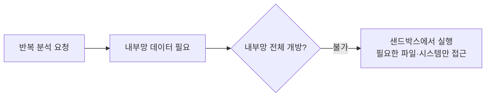

## Agent Platform 설계의 2가지 요구
1. **실행 격리**: 샌드박스에서 파일과 네트워크 접근을 어떻게 제한하는가
2. **세션 유지**: 실행 환경이 바뀌어도 이어서 작업하도록 작업 파일과 대화 상태를 어떻게 보관하는가
	- 지난번 코드와 집계 기준을 알아야 하고, 사용자가 매번 다시 준비하지 않아야 함

> - [GenAI Gateway와 MCP Gateway의 역할](https://toss.tech/article/ai-platform-foundation)

## 역할 분리: 플랫폼 vs 하네스
- 모델은 어떤 코드를 실행할지 결정만 함 — 직접 프로세스를 띄우거나 파일을 고치지 않음
- **하네스** (Workspace 안): 모델 응답 → 도구 실행 → 결과를 다시 모델에 전달하는 과정을 반복
	- 분석 코드 오류 → 모델에 전달 → 수정 코드 재실행도 하네스 담당
	- 기존 하네스를 그대로 사용
- **플랫폼** (Workspace 밖): 요청자 확인, 실행 환경과 접근 권한 준비
- 이점: 하네스를 교체해도 사용자 관리·저장소 연결을 다시 구현할 필요 없음

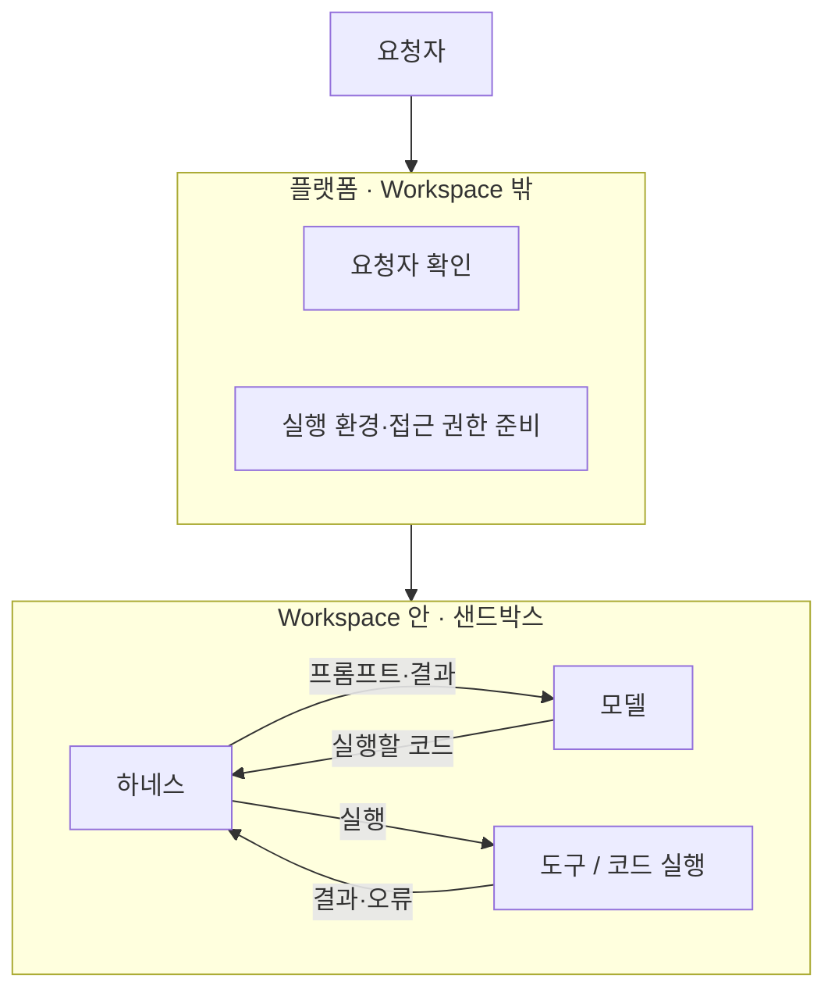

## 실행 단위: Workspace · Agent · Session
- 한 사용자가 여러 에이전트와 대화하므로, 실행 시 **누구의 작업 공간 / 어떤 에이전트의 대화**인지 구분 필요
	- **Workspace**: 사용자마다 제공하는 개인 작업 공간
	- **Agent**: 업무 지침과 사용할 도구를 설정한 에이전트
	- **Session**: 각 Agent와 나누는 개별 대화

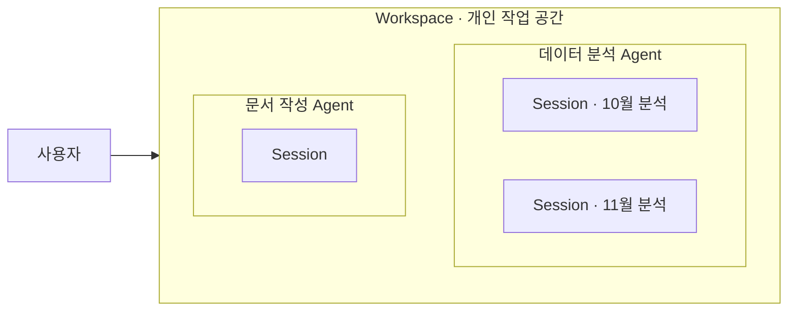

## 실행 환경: Workspace당 Pod 1개
- Workspace 실행 환경으로 Pod를 만들어 재사용
	- Agent·대화마다 만들면 환경 준비와 저장소 연결이 반복됨
- Pod를 함께 쓰더라도 Agent마다 접근할 파일·시스템은 제한 필요
	- 실제 작업 주체는 하네스 → **하네스를 격리**하고, 그 안의 도구·코드에도 같은 제한 적용
- 구현
	- [OpenSandbox](https://github.com/opensandbox-group/OpenSandbox)가 Kubernetes에 Workspace별 Pod를 생성·종료
	- Runtime은 Pod 안에서 bubblewrap으로 접근할 폴더·통신 경로를 제한한 뒤, 그 안에서 하네스와 도구를 실행

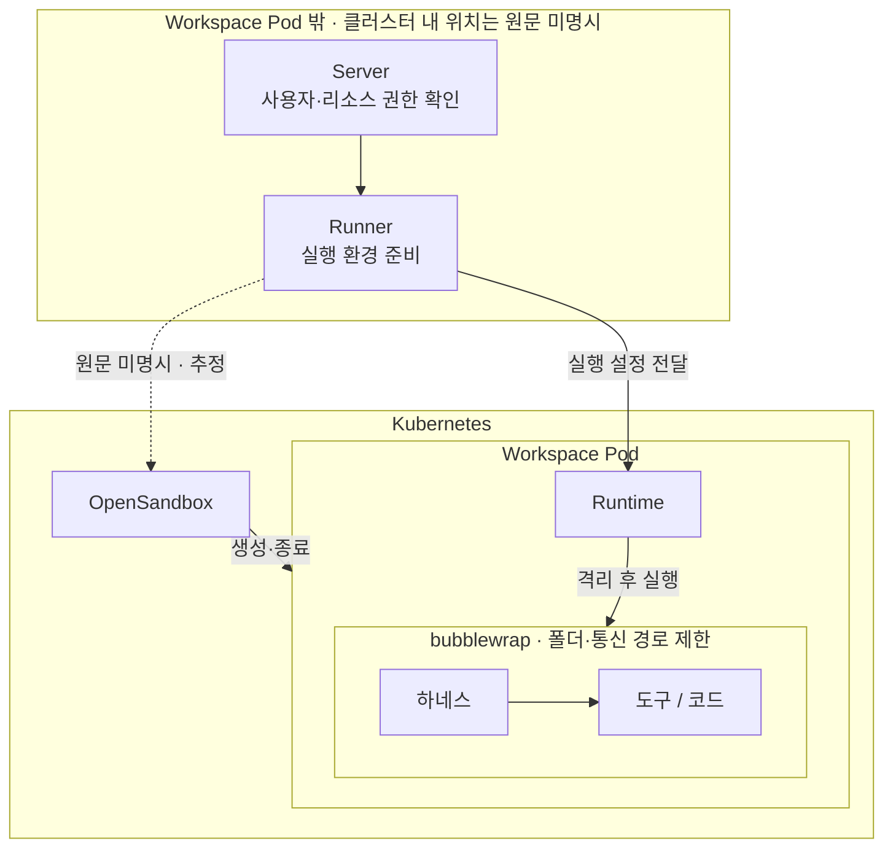

## 요청 처리 흐름
- Server·Runner는 Workspace Pod **밖**에서 동작

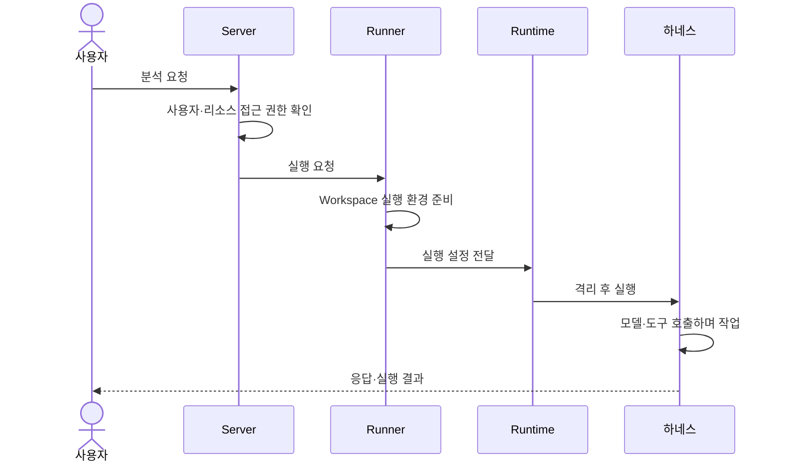

### Runner가 전달하는 "실행 설정"에는 무엇이 들어갈까
- 원문: Runner가 Runtime에 실행 설정 전달 → Runtime이 설정에 맞춰 하네스를 격리·실행 (설정 항목은 나열하지 않음)
- Runtime의 동작에서 거꾸로 짐작한 항목 (**추정**)

| 아마 들어갈 설정 | 근거 (Runtime의 동작) |
| --- | --- |
| 마운트할 폴더 | Agent 작업 폴더, 사용자가 추가 허용한 폴더, 현재 세션 상태 경로만 마운트 |
| 읽기 전용 경로 | 참고 자료처럼 수정이 필요 없는 경로는 읽기 전용 |
| 통신 경로 | bubblewrap으로 통신 경로 제한, HTTP(S)는 Runtime 프록시로만 |
| 이어갈 세션 정보 | 플랫폼이 기록한 세션 ID·상태 저장 경로를 다음 실행에 연결 |
| Agent 설정 | Agent = 업무 지침과 사용할 도구를 설정한 에이전트 |
| 실행 권한 | 권한을 낮춘 사용자로 실행, capability 제거 |

- 한 줄 요약: **이 하네스를 어느 Agent의 어느 Session으로, 어떤 폴더·통신·권한 범위 안에서 실행할지** 담은 지시서
- 확인 불가: Agent 지침·도구 설정이 Runtime을 거쳐 전달되는지는 원문에 없음

## 권한 경계
- 하네스에는 업무에 필요한 입력과 도구만 제공
- 플랫폼 DB 인증정보는 넘기지 않음
	- 분석 코드 실행에 다른 사용자의 설정이나 플랫폼 관리 기능 접근 권한은 필요 없음

## 같은 Pod 안에서 Agent의 접근 범위 나누기

- 요구: 분석 Agent는
	- 분석에 필요한 참고 문서는 읽을 수 있어야 함
	- 문서 작성 Agent의 작업 파일은 바꿀 수 없어야 함
- 화면에서 도구 목록을 숨기거나 파일 읽기 도구에서만 권한을 확인하는 것으로는 부족
	- 하네스가 셸 명령이나 직접 작성한 프로그램으로 같은 파일을 열 수 있음
- ➡️ 도구 종류와 관계없이 **코드를 실행하는 프로세스 자체**의 접근 범위를 제한
	- Runtime이 [bubblewrap](https://github.com/containers/bubblewrap)으로 하네스마다 별도 Linux namespace 구성

### VM vs namespace
| 방식 | 장점 | 플랫폼이 준비·관리할 것 |
| --- | --- | --- |
| Agent마다 별도 VM | Agent마다 게스트 커널까지 분리 | VM 생성·종료, 이미지 준비, 작업 볼륨 연결을 실행 흐름과 연동 |
| **Workspace Pod 안 namespace** (선택) | 기존 Workspace 안에서 하네스마다 파일·네트워크 범위 설정 | 기존 Kubernetes/OpenSandbox 구성 활용, 하네스별 파일/네트워크/실행 권한 설정과 격리 동작 검증 |

- 선택 이유: Workspace 실행 환경을 재사용하면서 하네스마다 접근 범위만 다르게 두는 것이 목표
	- 생성·종료는 Workspace 단위, 하네스 실행 시 허용한 폴더·통신 경로만 연결
	- Agent마다 게스트 OS를 준비·관리하지 않아도 됨
- 한계: 호스트 커널을 공유하므로 VM 수준의 커널 격리는 아님

### Runtime이 하네스 실행 시 제한하는 3가지
1. **파일**: 필요한 경로만 마운트
	- 기본 실행 파일 + Agent 작업 폴더 + 사용자가 추가 허용한 폴더 + 현재 세션 상태 경로
	- 다른 Agent의 작업 폴더, 다른 세션의 상태 경로는 연결하지 않음
	- 참고 자료처럼 수정이 필요 없는 경로는 **읽기 전용**
	- 쓰기 도구든 Python·셸이든 파일시스템이 거부 → 새 도구를 추가해도 같은 제한 적용
2. **프로세스·네트워크**
	- `PID namespace`로 보이는 프로세스 목록 격리
	- 별도 네트워크 namespace → Pod 네트워크 직접 사용 불가
	- HTTP(S) 요청은 Runtime 프록시로만 전달 (목적지 검사·인증 프록시는 뒤에서 설명)
3. **실행 권한**
	- 권한을 낮춘 사용자로 실행, `capability` 제거 → 하네스가 격리 설정을 바꿀 수 없음
	- 격리 준비에 실패하면 실행 중단 (격리 없이 실행하면 접근 제한을 지킬 수 없음)

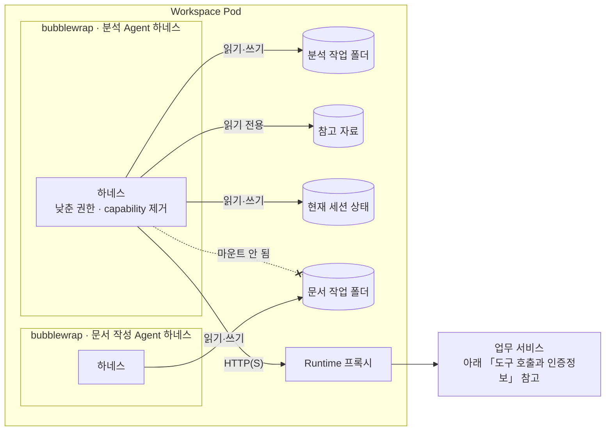

### 접근 제한 ≠ 작업 결과 검증
- 허용하지 않은 파일·시스템 접근만 막음
- 쓰기 허용 폴더 안에서 잘못 수정·삭제하는 것은 못 막음
- 분석 결과의 정확성도 별도 확인 필요

## Agent별 파일 접근 범위

- 분석 Agent: 같은 작업 폴더 사용
- 문서 Agent: 다른 작업 폴더 연결, 함께 필요한 참고 자료는 읽기 전용으로 연결

### 같은 Agent의 여러 대화가 무엇을 공유할지
- 대화마다 작업 폴더를 따로 만들면
	- 장점: 파일 충돌 감소
	- 단점: 지난 대화의 코드를 새 대화로 복사해야 하고, 어느 사본이 최신인지 사용자가 관리해야 함
- ➡️ **파일과 대화 상태를 분리 관리**: 대화는 나누되 분석 코드·참고 자료는 계속 사용

| 구분 | 범위 | 예시 / 의미 |
| --- | --- | --- |
| 작업 파일 | 같은 Agent의 대화들이 **공유** | 지난달 만든 `compare.py`를 새 대화에서도 읽고 실행, 한 대화에서 수정하면 다른 대화도 수정본 사용 |
| 대화 상태 | **Session마다** 따로 보관 | 기존 대화를 이어가면 저장된 상태 활용, 새 대화에는 이전 분석 조건이 자동 전달되지 않음 → 조건·작업 요약 필요 |

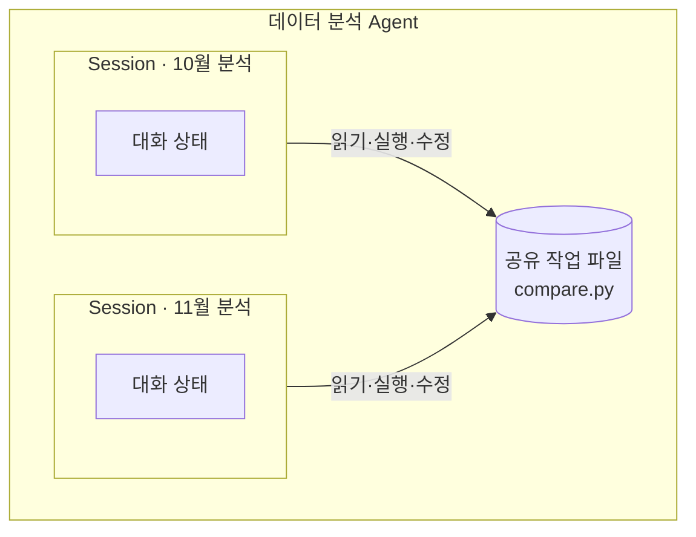

- 주의: 파일 버전
	- 이전 대화를 열어도 파일은 당시 버전으로 돌아가지 않음
	- 여러 대화에서 같은 파일을 동시에 수정하면 충돌 가능

## 도구 호출과 인증정보: 하네스에는 대체 키만 전달

OpenSandbox 인증 프록시를 사용하는 HTTP(S) 호출

- 목표: 하네스가 업무 시스템 데이터를 조회할 수 있게 업무 도구에 연결하되, 필요한 서비스로만 통신 경로 제한
- 하네스의 HTTP(S) 요청은 전용 **Unix 도메인 소켓**으로 `Runtime HTTP` 프록시에 전달
	- IP 네트워크를 거치지 않고 같은 호스트의 프로세스끼리 연결
	- → Pod 네트워크를 열어 주지 않고도 지정한 프록시로만 요청 가능
- 하네스 네트워크는 Pod와 격리 → 프록시 환경변수를 무시해도 Pod 네트워크로 직접 통신 불가

### 내부망 구성의 통신 두 단계 제한
| 단계 | 하는 일 | 성격 |
| --- | --- | --- |
| 1. Runtime HTTP 프록시 | 요청 목적지 확인, Pod 자신의 주소처럼 접근하면 안 되는 대상 차단 | 어디서나 같은 공통 관문 ("여기는 안 됨") |
| 2. OpenSandbox egress 정책 | 업무 서비스 등으로 나가는 통신의 허용 목적지 지정 | 환경마다 따로 설정 ("여기는 가도 됨") |

- Runtime 프록시를 거친다고 모든 환경에 같은 통신 정책이 적용되는 것은 아님
	- 접속을 허용할 업무 서비스가 환경마다 다르므로 egress 정책도 환경에 맞게 설정

- 모델 호출: **GenAI Gateway**를 거침
- 업무 도구 호출: **MCP(Model Context Protocol) Gateway**를 거침
	- 하네스는 Gateway를 통해 샌드박스 밖 업무 서비스의 기능을 요청

### 호출에 필요한 인증정보 보호
- 접속할 서비스를 제한하는 것과는 별개의 문제
- 실제 API 키를 하네스 환경변수에 넣으면
	- 하네스가 실행한 코드에서도 그 값을 읽을 수 있음
	- 디버깅용 환경변수 출력이 로그·결과 파일에 섞일 수 있음
- 호출에 키는 필요하지만, 하네스가 그 값을 직접 알 필요는 없음
- ➡️ 인증정보를 대신 넣어 주는 **OpenSandbox 인증 프록시** 사용 (지원하는 HTTP(S) 연동에 한함)
	1. 하네스가 요청 헤더에 실제 키 대신 대체값 삽입
	2. Runtime HTTP 프록시가 목적지 검사 후 요청 중계
	3. OpenSandbox 인증 프록시가 미리 정한 목적지로 보낼 때, 지정된 헤더의 대체값을 실제 인증정보로 변경

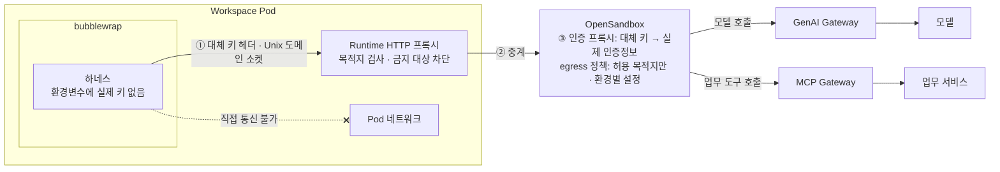

### 키를 숨기는 것 ≠ 사용 권한 제한
- 하네스는 프록시를 통해 그 키에 허용된 기능을 그대로 사용 가능
	- 예: 문서 검색 서비스 사용 권한 ≠ 그 안의 개별 문서 읽기 권한
- 권한 확인은 각 단계에서 따로 필요
	- Gateway: 모델·도구 사용 권한
	- 업무 서비스: 해당 계정의 데이터 접근 권한
- 데이터 반출도 이 구조만으로는 다 막지 못함
	- 읽은 데이터를 접속이 허용된 서비스로 보내는 것은 가능
	- ➡️ **읽을 파일 · 연결할 곳 · 그곳에서 할 작업**을 함께 정해야 함

> [!note] 인증정보 대체 방식의 적용 범위
> OpenSandbox 인증 프록시가 지원하는 HTTP(S) 연동에만 적용. 모든 CLI나 개인 구독의 인증정보를 같은 방식으로 처리하는 것은 아님

## Pod가 바뀌어도 분석 작업 이어가기

- 샌드박스 실행 환경은 배포·장애로 교체될 수 있음 → Pod가 없어져도 작업 파일과 대화 상태는 남아야 함
- 세 가지를 나누어 보관

| 보관 대상 | 위치 | 쓰임 |
| --- | --- | --- |
| 작업 파일 | 영속 볼륨(PV) | 새 Pod에서 다시 읽고 실행 |
| 하네스가 저장한 세션 상태 | 영속 볼륨(PV) | **세션 재개** |
| 공통 실행 기록 | 플랫폼 | **이력 조회 · 요약 인계** |

- 새 Pod를 만들면 PV를 다시 연결 → Runtime이 작업 폴더·세션 상태 경로를 마운트 → 새 하네스가 저장된 상태를 읽고 다음 요청 처리
- 복구되지 않는 것: 종료된 프로세스의 메모리
	- 파일로 저장한 분석 결과는 다시 읽을 수 있지만, 메모리에만 있던 중간 계산값은 다시 계산

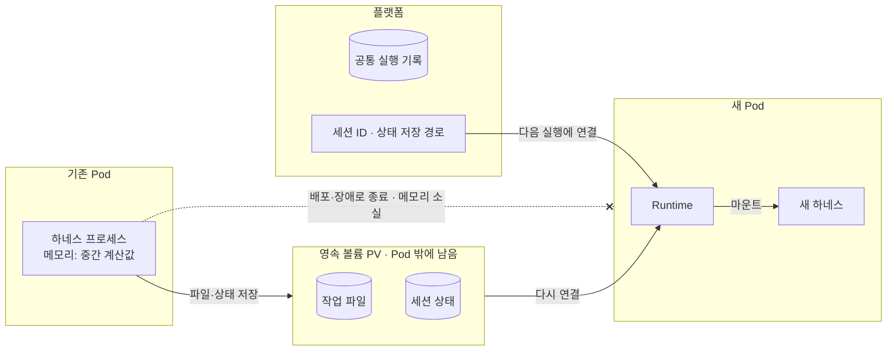

### 대화 상태에 무엇을 저장할까
- 화면의 질문·최종 답변만으로는 부족
	- 조회 도구를 여러 번 호출했다면 각 결과가 어느 호출에서 나왔는지 알아야 다음 요청 처리 가능
	- 긴 대화를 압축한 내용 등 하네스 내부 관리 정보도 필요

| 방식                 | 내용                                                                    | 문제 / 효과                               |
| ------------------ | --------------------------------------------------------------------- | ------------------------------------- |
| 처음: 변환 복원          | 플랫폼 대화 기록을 하네스 형식으로 변환해 복원                                            | 하네스가 도구 호출·결과 연결 방식을 바꾸면 변환 코드도 수정 필요 |
| **변경: 하네스 상태 재사용** | 같은 하네스로 이어갈 때 그 하네스가 저장한 상태와 세션 ID를 그대로 사용, 플랫폼은 저장 경로만 기록해 다음 실행에 연결 | 플랫폼이 하네스 내부 형식을 재현·관리할 부담 감소          |

- 남는 문제: 하네스 버전이 바뀌면 기존 상태를 읽을 수 있는지 확인 필요

### 이어가기 vs 오류
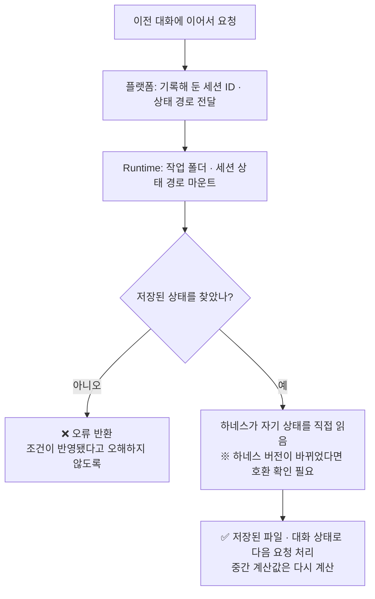

- "이어간다" = 끊긴 작업을 자동으로 계속하는 게 아니라, 저장된 파일·대화 상태를 연결해 두고 **사용자의 다음 요청을 이전 맥락으로 처리**하는 것
- 세션 재개가 해 주지 않는 것
	- 실패한 작업을 멈춘 지점부터 다시 실행
	- 수정한 파일을 이전 버전으로 되돌리기
	- 외부 서비스에서 이미 처리한 작업 되돌리기
- ➡️ 데이터 백업과 외부 작업 중복 실행 방지는 별도로 다뤄야 함

## 세션 재개와 이력 조회에 다른 기록
- 지난 대화를 화면에 보여 줄 때는 하네스 상태 파일을 직접 읽지 않음
	- 하네스마다 저장 형식이 달라, 조회 기능을 형식 변화마다 수정해야 하기 때문
- ➡️ 하네스 실행 중 사용자 입력·도구 호출·실행 결과를 **공통 형식**으로도 남김 = **공통 실행 기록**
	- 메시지와 도구 호출 결과는 [OpenResponses](https://www.openresponses.org/) 형식으로 저장
	- 하네스가 남긴 원본 이벤트도 함께 보관
	- 조회 시 저장된 기록만 읽으면 되므로 하네스를 다시 실행할 필요 없음

| 사용 목적 | 사용하는 기록 | 처리 방식 |
| --- | --- | --- |
| 같은 하네스에서 대화 이어가기 | 하네스 고유 상태 + 세션 ID | 하네스가 저장된 상태를 읽어 다음 요청 처리 |
| 화면에서 지난 대화 조회 | 공통 실행 기록 | 하네스 실행 없이 메시지·도구 실행 결과 조회 |
| 다른 하네스로 작업 넘기기 | 공통 실행 기록 + 허용된 작업 파일 | 별도 인계 요청 시, 요약을 전달한 새 세션에서 시작 |

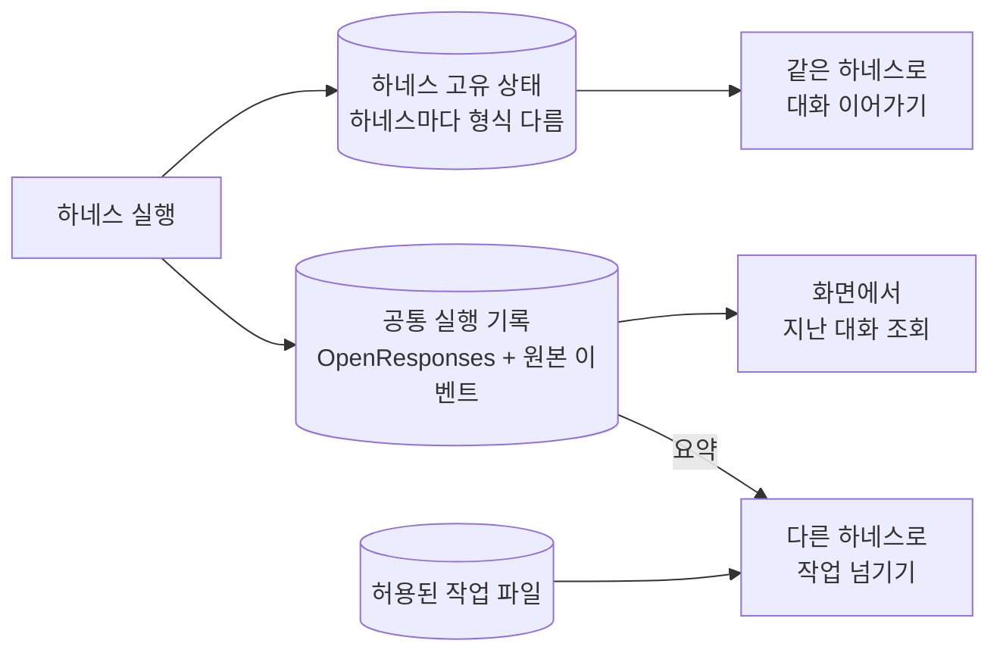

### 다른 하네스로 작업 넘기기
- 기존 상태 파일은 다른 하네스에서 그대로 쓸 수 없음
- 인계 요청 시 공통 실행 기록을 요약해 **새 세션**에 전달
	- 이전 세션 복원이 아니라, 요약을 참고해 새 대화를 시작
	- 예: 지난 분석의 집계 조건과 결과 파일 위치를 전달 → 새 하네스가 이 설명과 허용된 작업 파일로 작업 시작
- 요약에서 빠진 내용을 확인할 수 있도록 원문 기록도 보관
- 기록을 읽지 못하면 요약을 만들지 않고 오류 반환
- 복원 실패 시 자동으로 인계 방식으로 전환하지 않음 → 이어가기 / 요약 인계는 **요청할 때 구분**

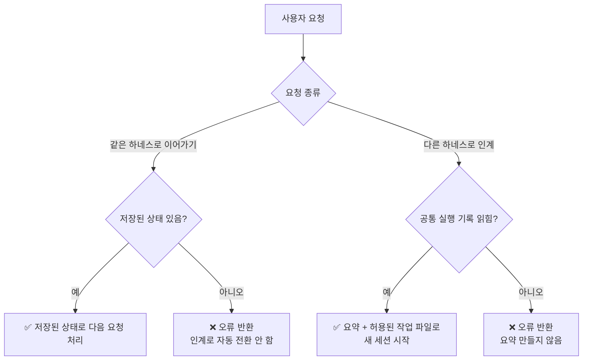

- 트레이드오프: 기록을 두 종류(하네스 고유 상태 · 공통 실행 기록) 관리해야 하지만, 대화 조회·요약 기능을 하네스별 저장 형식에 맞춰 구현하지 않아도 됨

## 다음 분석도 같은 곳에서 이어갈 수 있도록
- “지난달과 같은 기준으로 이번 달 데이터도 비교해줘.”를 처리하려면
	- 지난번 코드·결과 파일 + **어떤 기준으로 분석했는지**까지 알아야 함
	- 그 과정에서 필요 범위보다 많은 파일·시스템을 열어서는 안 됨

| 구성 | 내용 |
| --- | --- |
| 접근 제한 | 하네스가 실행하는 코드에도 파일·네트워크 접근 제한 적용 |
| 작업 유지 | Pod가 바뀌어도 같은 하네스에서 대화를 이어가도록 작업 파일·대화 상태 보관 |
| 공통 기록 | 하네스와 관계없이 이력 조회, 다른 하네스로 넘길 때는 요약을 전달한 새 세션에서 시작 |

- 앞으로: 사용자가 에이전트와 같은 작업 공간에서 직접 파일 수정, 팀원과 에이전트 공유
- 다음 편: 대화창 밖(터미널·팀 업무 도구)에서 에이전트를 쓰기 위한 연결

---

# 용어
- 하네스(harness): AI 에이전트에서 모델 바깥을 감싸서 모델이 실제로 일할 수 있게 만드는 실행 틀
- Pod: Kubernetes의 최소 실행 단위. 컨테이너 하나 이상을 묶어 함께 배포·실행
- [OpenSandbox](https://github.com/opensandbox-group/OpenSandbox): Kubernetes 위에서 샌드박스 실행 환경(Pod)을 생성·종료하는 오픈소스
- bubblewrap: 리눅스 네임스페이스로 프로세스가 볼 수 있는 파일·네트워크를 제한하는 경량 샌드박스 도구 (Flatpak이 사용)
- chroot (change root): 프로세스가 보는 파일시스템의 루트(`/`)를 다른 폴더로 바꾸는 리눅스·유닉스 기능. "chroot 감옥(jail)"
	- 예: `chroot /jail bash` → bash에게는 `/jail`이 `/`, 바깥 폴더는 막힌 게 아니라 경로 자체가 없음
	- "처음부터 안 보이게 한다"는 발상의 원조. 단, 파일시스템만 격리하고 root 권한이면 탈출 가능해 보안용으로는 약함
	- bubblewrap·도커 컨테이너는 이 발상을 namespace로 넓히고(프로세스·네트워크까지) 단단하게(capability 제거) 만든 것
- namespace: 프로세스마다 파일시스템의 마운트 구성, 프로세스 목록, 네트워크 등을 격리할 수 있는 Linux 기능
- `capability`: root 권한을 기능별로 쪼갠 Linux 특수 권한 단위 (예: 네트워크 설정, 마운트). 제거하면 root처럼 시스템 설정을 바꿀 수 없음
- Unix 도메인 소켓: IP 네트워크 없이 같은 호스트의 프로세스끼리 통신하는 소켓
- egress: 실행 환경에서 바깥으로 나가는 통신
- MCP: 에이전트가 외부 도구의 기능을 확인하고 호출할 수 있도록 정한 인터페이스.
- PV: 영속 볼륨(Persistent Volume). Pod가 삭제·교체돼도 데이터가 남는 Kubernetes 저장소. 새 Pod에 다시 연결해 사용
- [OpenResponses](https://www.openresponses.org/): 모델 응답과 도구 호출을 일관된 구조로 표현하기 위한 공개 규격
- 하네스 형식(세션 상태): 하네스가 대화를 이어가려고 자기 방식으로 저장하는 세션 파일 구조. 하네스마다 다르고 표준 없음
	- 플랫폼 기록은 화면용(질문 → 최종 답변), 하네스 형식은 다음 요청 처리용
	- 예: Claude Code는 `~/.claude/projects/<프로젝트>/<세션>.jsonl`에 한 줄씩 저장
		- `tool_use`(모델의 도구 호출 요청, 고유 id) ↔ `tool_result`(어느 `tool_use_id`의 결과인지 연결)
		- 그 밖에 압축 요약·권한 모드 등 하네스 내부 상태
	- 하네스가 이 구조를 바꾸면 변환 코드도 수정 필요 → 토스는 하네스가 저장한 파일을 그대로 다시 읽게 함

---
## 느낀점

- 에이전트를 실제 업무에 쓰려고 격리, 권한, 상태 보관, 기록까지 갖춘 틀을 만들었다.
- AI를 직접 다루는 부분(모델 호출 → 도구 실행 → 결과 전달을 반복하는 루프)은 기존 하네스에 맡기고 AI가 안전하게 일할 수 있는 작업 환경을 만들었다.(요청자 확인, 실행 환경과 권한 준비, 파일·상태 보관, 공통 기록)

- Runtime: 서비스 주소록(유레카)이 아니라 설정대로 격리를 걸고 하네스를 띄우는 **컨테이너 런타임**에 가까움
- bubblewrap: 요청이 지나가는 길목(API Gateway)이 아니라 하네스를 가둬 두는 **컨테이너(샌드박스)**에 가까움
- 게이트웨이처럼 요청이 반드시 지나가는 길목은 bubblewrap이 아니라, 하네스가 바깥(모델, 업무 서비스)으로 요청을 보낼 때 거치는 프록시들이었다
- bubblewrap과 프록시는 비슷하다기보다 **짝**이다.

|           | bubblewrap                                                          | 프록시 (Runtime 프록시 → 인증 프록시·egress → GenAI·MCP Gateway) |
| --------- | ------------------------------------------------------------------- | ----------------------------------------------------- |
| 역할        | 하네스가 볼 수 있는 세상을 **처음부터 좁혀 둠** (허용한 폴더만 존재, 네트워크는 프록시로 가는 통로 하나만 존재) | 그 하나뿐인 통로의 **검문소**                                    |
| 언제        | 실행 **전에** 한 번 정함                                                    | 실행 **중** 요청이 **올 때마다** 판단                             |
| 무엇을       | 하네스 세계에 무엇이 존재하는지 (보이는 폴더, 쓸 수 있는 네트워크)                             | 요청 하나하나의 목적지·인증·권한                                    |
| 요청을 보나    | 안 봄, 중계도 안 함                                                        | 받아서 검사하고 전달                                           |
| 허용 안 된 대상 | 처음부터 **존재하지 않음**                                                    | 요청은 오지만 **거절됨**                                       |
| 가까운 비유    | 컨테이너 · chroot (방화벽은 오는 걸 막지만, 이건 처음부터 안 보이게 함)                      | 게이트웨이                                                 |

- API Gateway도 뒤쪽 서비스로 직접 가는 길을 막아야 의미가 있는 것처럼, bubblewrap이 그 "직접 접근 차단"을 맡는다.

| 구성 요소 | 가까운 비유 |
| --- | --- |
| Server | 들어오는 요청의 입구, 권한 확인 → API Gateway (ingress) |
| Runtime | 컨테이너 런타임 · kubelet |
| bubblewrap | 컨테이너 · chroot 감옥 |
| Runtime HTTP 프록시 | 포워드 프록시 · egress 게이트웨이 |
| OpenSandbox 인증 프록시 + egress 정책 | 서비스 메시 사이드카(Envoy)의 인증 주입 · egress 정책 |
| GenAI · MCP Gateway | 모델·도구 호출용 API Gateway |
| 세션 ID와 상태 경로 | 세션 상태 위치를 찾는 주소록 (유레카와 느슨하게 비슷) |

- 보통 API Gateway는 **들어오는** 요청을 다루는데, 이 글의 프록시들은 AI가 **나가는** 요청을 다룬다는 점이 반대라서 흥미로웠다.
